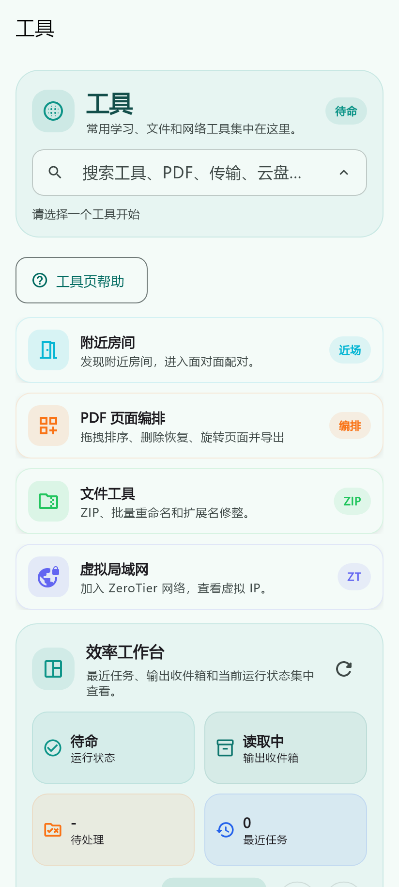
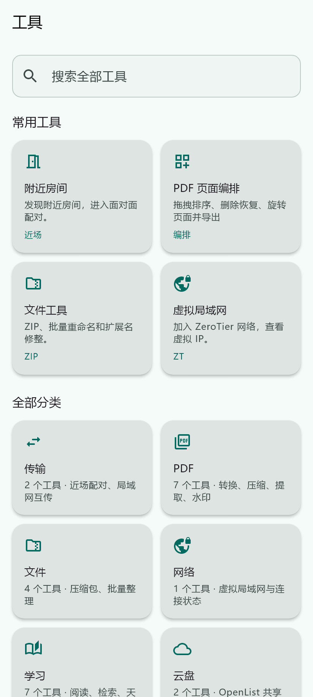
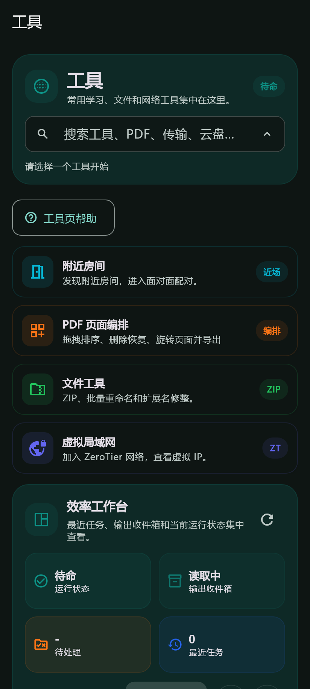
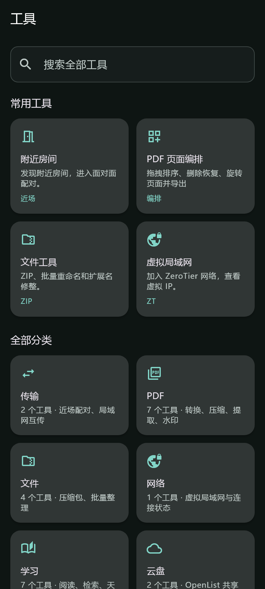

# beta 重构验收记录

## 交付范围

基于原工作区创建 `beta`，原有 13 个已修改文件和 8 个未跟踪报告保持保留。修改前差异保存在本机 `_tmp/beta-baseline/working-tree.patch`。未推送、未发布，未改变包名、版本、登录存储键、插件协议及平台路由。

### 已实施

- 公共主题提取为独立模块；Material 3 表单、48dp 按钮、轻提示、底部面板、卡片点击反馈统一。保留原主题风格及配色；系统减少动画和低功耗模式作用于公共动画。
- 主导航即时响应，按 ID 选择，首次访问再创建页面；访问过的页面在切换、排序和隐藏后保留状态，不可见页面停用 ticker 和焦点。会话健康提示占据实际布局空间，不遮住内容。
- 课程缓存按平台与账号隔离；请求和磁盘快照均检查时效，旧请求不能覆盖新页面。空课程列表与请求失败分别处理。
- 账号切换防重复、显示切换状态和失败提示；批量移除账号确认具体数量。原新增的账号更新面板保留。
- 待办使用各平台选中的账号，按账号隔离在途数据和快照；提醒恢复从页面构建移至应用启动服务。进入页面只检查权限，通过显式提醒按钮再申请；通知初始化失败不阻断待办加载。其他平台的待办结果不因局部失败被清空。
- 工具转盘改为页内搜索、常用入口和分类网格；分类点击直接打开详情。原 28 个工具动作、工作流、文件输出管理、PDF 输出动作和动态插件注册流程保留。
- 登录表单增加键盘逐项填写、完成提交、自动填充提示和及时校验；禁止重复登录请求，失败不清空输入。
- 考试同题答案保存按顺序执行，旧响应不覆盖新输入；失败保留未保存标记。交卷防重入，成功后防重复交卷；系统返回/工具栏返回支持继续编辑、保存离开或明确放弃。原题型、答题卡、计时和身份水印保留，页面颜色遵循主题。
- 刷新失败时展示保留内容与重试提示。修复原有登录乱码和课堂派凭据未经服务器验证就延长本地有效期的问题。

## 功能与入口核对

| 功能 | 新入口/处理 | 验证范围 |
|---|---|---|
| 学习通、雨课堂、畅课、课堂派、微助教 | 课程、账号及原平台专属页 | 既有 API/控制器测试；账号上下文新增测试。微助教继续保持原有支持边界 |
| 签到、课堂活动、多账号与共享房间 | 保留原课程操作及相关独立页面 | 既有签到、请求、控制器、二维码解析测试 |
| 作业、考试、附件上传 | 保留原课程详情与待办入口 | 既有上传与考试测试；新增保存竞态、防重复提交测试 |
| 待办、提醒、时间轴相关能力 | 保留原待办与现有页面入口 | 数据与相关服务测试；通知硬件未实测 |
| PDF、文件工具、OCR、全文搜索、复习 | 工具分类、直接搜索与固定入口 | 原工具动作 ID 全量对照；既有文件/资料/复习测试 |
| 云盘、离线包、文件输出与分享 | 原分类详情及工具工作流 | 原仓库服务及页面测试；真实服务端未实测 |
| 局域网传输、附近房间、ZeroTier | 工具分类与原命名路由 | 原协议、控制器与存储测试；双设备测试未实测 |
| Mod 插件、诊断、设置、更新 | 原入口、插件注册及设置页 | 原插件、诊断、布局、更新测试 |

静态工具入口完整清单见 [tool-inventory.md](tool-inventory.md)。代码和测试证明的范围不等同于真实平台端到端验证。

## 操作步骤对照

| 场景 | 原流程 | 新流程 |
|---|---|---|
| 主导航切换 | 点击后等待缩放动画完成 | 点击立即切换；再次进入保留输入和列表状态 |
| 搜索工具并打开 | 点搜索框 → 弹出搜索面板 → 输入 → 点结果 | 在页面输入 → 点结果；不产生搜索弹层 |
| 打开工具分类 | 选分类 → 点击转盘中心/查看全部 | 点分类卡片直接进入详情 |
| 账号切换 | 连续点击可产生多个异步请求 | 首次点击后显示切换状态，完成前防重复 |
| 保存失败后离开考试 | 可能直接离开并丢失未保存输入 | 显示明确选择；保存失败留在当前页面 |
| 刷新失败 | 有缓存时可能仅显示旧内容 | 原内容保留，同时展示失败状态与重试入口 |

## 自动验证

- 修改前恢复依赖后：`flutter analyze --no-pub` 无问题；完整测试 510 通过、2 失败。
- 本次完整测试：539 项全部通过。包含原有回归及新增导航、搜索、上下文竞态、保存顺序、防重复提交和返回保护测试。
- 工具目录布局检查：360/412/600dp × 深浅色 × 中英文 × 1/2 倍文字，共 24 个组合，无布局异常。
- 实际工具页前后深浅色渲染：4 个场景通过；使用本地字体与公共主题，关闭外部服务初始化，不是 Android 真机截图。
- 最终 `flutter analyze --no-pub` 无问题，`git diff --check` 通过；最终 Android arm64 Release 构建成功，APK v2 签名校验通过。

## 安装包

- 本地文件：`build/app/outputs/flutter-apk/GUETer-beta-1.0.14-arm64.apk`。
- 大小：90,282,348 字节（约 86.1 MiB）。包名 `com.gueter.cszm`，版本 `1.0.14`，arm64 分包 versionCode `2015`，最低 Android 10（API 29）。
- SHA-256：`C555FE4EBAFDE8BBE1750BF1149D73C275210F8A5720F0C5FF63572DED3CD650`。
- 使用现有本机签名配置，未安装到设备、未推送或发布。结构化结果见 [validation.json](validation.json)。

## 界面对照

| 原工具布局 | 新工具布局 |
|---|---|
|  |  |
|  |  |

本机复现：`powershell -File docs/beta/render_tools.ps1`。脚本读取 `main` 上的原工具布局，临时禁用外部服务初始化并在结束时移除临时页面；渲染模板使用本机 Flutter 图标字体及 Windows 微软雅黑路径。

## 尚需真实环境验证

当前 `adb devices` 未发现设备，因此以下内容未实测：真实五平台账号登录和提交、相机与位置权限、扫码签到、OCR 硬件、通知触达、TalkBack、双设备传输，以及同设备启动耗时、帧率与网络请求次数的前后比较。未提供虚构性能数字，也未以模拟测试替代这些结论。

整个应用没有进行逐页真机视觉验收；改造通过公共主题覆盖已有组件，高频页面另有专门调整。其余功能页的保留和兼容以源码入口核对及现有回归测试为依据。
