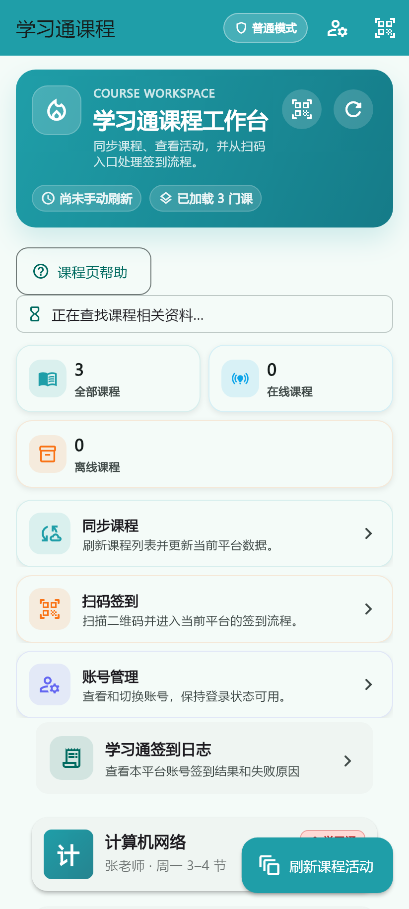
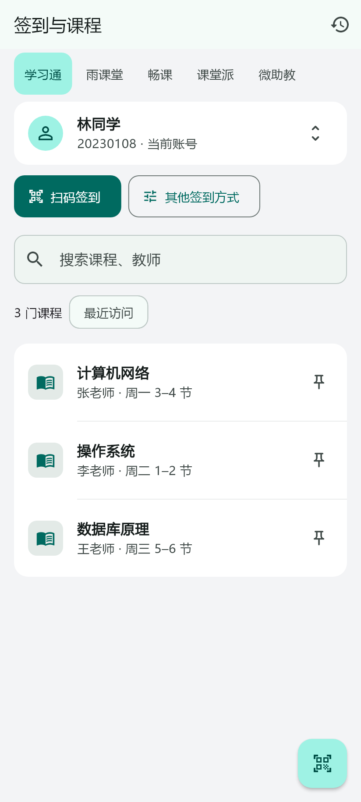
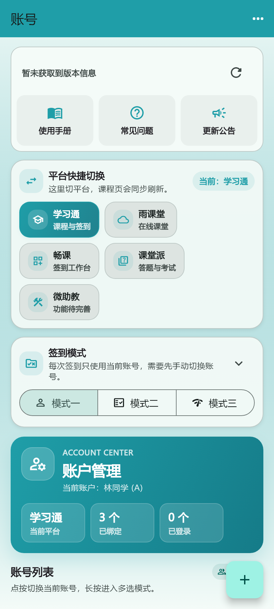
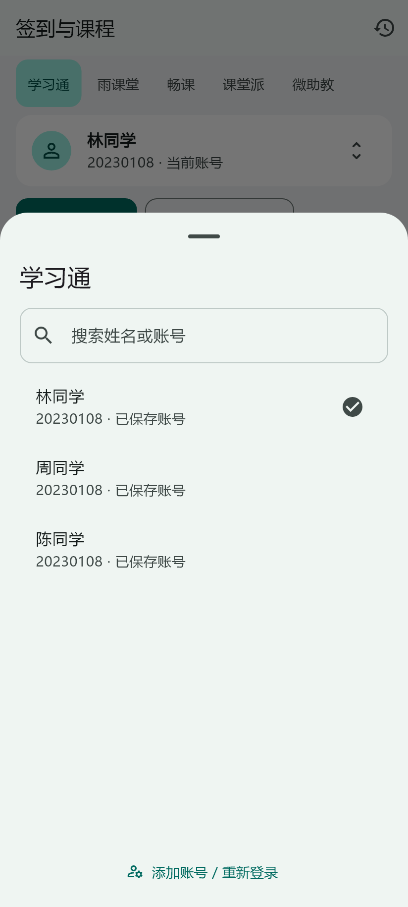
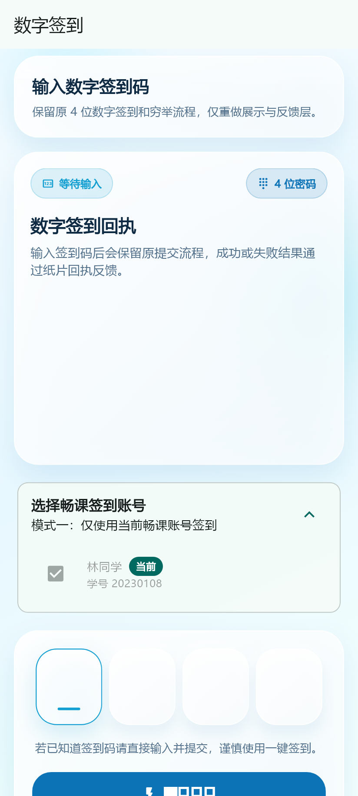
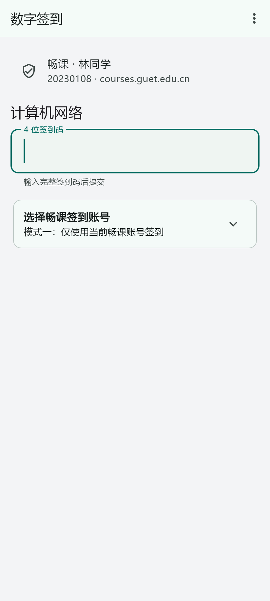
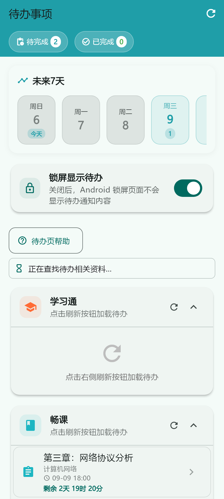
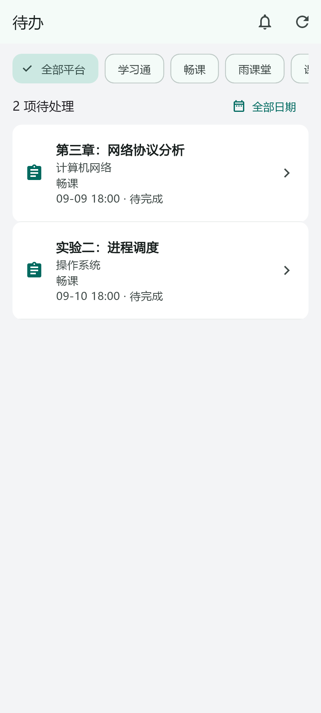
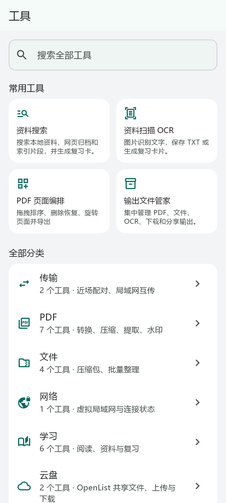

# GUETer beta 第二轮交付

本轮围绕签到、平台与账号切换实施。默认导航为 **课程 / 待办 / 工具 / 我的**，课程页首屏直接扫码，账号在底部面板点选切换。未推送远端、未发布版本、未清除用户数据。

## 提交与安装包

- `4277305`：上一轮应用、测试与验收记录的检查点，539 项测试通过。
- `86e1d6b`：签到任务与上下文隔离、快捷切换和课程工作台。
- `04826cf`：进一步修复站点隔离、写请求重试、页面退出后的任务执行；完善核心签到页面。
- 最后一笔 `feat: simplify beta navigation and everyday workflows`：四栏导航、工具与待办精简、验收测试和本目录。实际哈希见 `git log`。

安装包：[GUETer-beta2-1.0.14-arm64.apk](../../build/app/outputs/flutter-apk/GUETer-beta2-1.0.14-arm64.apk)。包名 `com.gueter.cszm`，版本 `1.0.14`，arm64 versionCode `2015`，最低 Android 10 / API 29。大小 90,084,676 字节，APK v2 签名验证通过。

SHA-256：`190DA68FF2C9EB1564470358F19ACB9C87A9C14D64F1F5CF54008986004AF977`。

第一轮 APK 和文档保留在原位置，第二轮请使用文件名包含 `beta2` 的安装包。独立分析报告保留为原有未跟踪文件，未混入应用提交。

## 核心交互

| 流程 | 第一轮 | 第二轮 | 验证证据 |
|---|---|---|---|
| 切平台 | 依赖平台专属页面或账号管理入口 | 课程页横向平台栏，点击一次 | 真实账号头部组件测试；本地已保存账号恢复测试 |
| 同平台切账号 | 到账号管理再返回课程 | 点当前账号 → 点目标账号，共两次 | `beta2_workspace_interaction_test.dart` |
| 开始扫码 | 顶部图标或较下方快捷卡片 | 首屏文字按钮 + 右下扫码按钮 | 360/412/600dp 首屏按钮位置和 48dp 触控高度测试 |
| 雨课堂普通扫码 | 每次弹窗选择扫码方式 | 自动按二维码类型分流；手动方式留在“其他签到方式” | 原解析与请求参数测试保留；真实二维码未实测 |
| 跨平台 / 雨课堂站点二维码 | 可能沿用全局选择 | 当前流程先明确目标并选择账号；扫描页更新本次身份 | 上下文隔离测试；实际相机流程未实测 |
| 找课 / 返回课程 | 账号切换容易产生旧内容 | 按平台、站点、账号隔离缓存、搜索、筛选与滚动；置顶优先，支持最近访问排序 | 请求代次、搜索返回、置顶和偏好隔离测试 |
| 签到进行中离开 | 部分流程依赖页面或临时修改当前会话 | 任务由控制器持有，可收起；切换不会恢复旧账号 | 去重、任务收起再进入、无页面上下文的网络恢复测试 |
| 网络异常 / 结果不明 | 底层客户端可能重试写请求 | 已发出的签到写请求不自动重发；保留任务记录和核实入口 | 实际 Dio 测试适配器验证签到 GET / 写 POST 各仅调用一次 |
| 处理待办 | 正文前有统计、建议面板；跨平台操作有额外提示 | 筛选后直接列事项；畅课与雨课堂入口先恢复对应账号 | 组件矩阵；真实作业、考试提交未实测 |
| 工具与文件 | 常用区、分类网格和多个说明面板 | 页内搜索、四个常用项、分类列表；最近文件直接打开 / 分享 | 实际 ToolsPage 搜索、目录和工作流行为测试；系统分享未实测 |

课程偏好使用新命名空间按上下文保存，不改账号、会话及原布局存储键。查询、筛选和滚动的返回保留是页面生命周期内的内存状态；课程置顶与访问顺序持久保存。

## 签到与切换的实现边界

- `AccountContextController` 串行处理平台、账号、雨课堂服务器及站点切换；连续选择合并为最后目标。失败回滚本地选择，不用超时冒充完成。
- `SignExecutionContext` 固定平台、站点和账号快照，通过异步作用域传递到现有请求层；客户端按账号及站点隔离。保留现有状态管理、平台请求格式和插件协议。
- 学习通、雨课堂和畅课签到不再通过临时切换全局账号执行批量请求。雨课堂 bearer / lesson token 按站点与账号隔离；畅课默认站点沿用原 session 键，其他站点独立存储。
- 签到任务显示实际阶段和逐账号记录；批量账号可以展开。相同目标与账号的进行中请求去重。网络处理串行，等待用户继续时暂停后续提交，不提供撤回已提交请求的假取消按钮。
- 学习通和畅课任务提供已有 API 的只读查询；平台未提供可复用的直接查询时，任务面板提供按本次账号打开课程核实的入口。这个入口是用户主动操作，会选择对应账号；任务自然完成不会抢回旧账号。
- 相机失败提供重试和应用设置入口；请求结果不明不自动重发。数字签到失败保留输入，未保存内容可以继续编辑、暂存于本次进程或放弃。
- 本轮保留三种签到账号模式、已有网络处理策略和平台特有能力。微助教按原有未完整接入状态展示。

## 功能保留与移除

| 能力 | 本轮入口 / 处理 | 验收范围 |
|---|---|---|
| 五个平台的账号、会话与站点 | 课程顶部快捷切换；我的 → 账号管理；原账号路由保留 | 本地切换、存储与既有接口测试；真实登录未实测 |
| 普通、二维码、数字、手势、位置等已有签到 | 扫码 / 其他签到方式 / 原课程活动 | 解析、模式、去重、网络及隔离测试；真实提交未实测 |
| 课堂活动、作业、考试、上传 | 原课程页面、平台专属页和待办 | 完整既有回归；真实教学平台未实测 |
| 待办、提醒与历史 | 默认待办；提醒设置入口 | 原通知服务测试保留；通知和后台硬件未实测 |
| 资料搜索、OCR、PDF、复习、输出文件 | 工具默认常用项与分类；最近文件 | 26 个实际静态工具动作保留，其中 PDF 7 项；原资料与文件测试 |
| 云盘、传输、聊天、ZeroTier | 工具分类和原路由 | 原协议与服务测试；服务器和双设备场景未实测 |
| 插件、工作流、文件历史 | 工具次级入口；用户排序、隐藏、固定优先 | 实际目录、工作流入口及既有插件测试 |
| 设置、主题、语言、帮助与更新 | 我的；原 `/settings`、`/accounts` 等路由保留 | 默认四栏迁移、自定义布局保留、账号独立入口恢复测试 |
| 课程置顶 / 最近访问 | 课程列表右侧置顶，最近访问筛选 | 按账号上下文隔离及持久化行为测试 |
| 天文图与 AI 形象 | 移除工具入口；删除 APOD 专属页面与 NASA 加载服务 | 工具目录 28 → 26；旧用户缓存和文件没有删除 |
| 首页建议、帮助和装饰统计 | 从高频页面正文移走 | 前后页面渲染；帮助与智能整理仍有独立入口 |

学习通和课堂派待办原先并非都有可直接操作的详情页。本轮提供对应账号的课程入口继续处理，未宣称补齐所有待办详情能力；没有扩展新平台或 AI 服务。

## 自动验证

| 检查 | 最终结果 |
|---|---|
| `flutter analyze --no-pub` | 无问题 |
| `flutter test --no-pub` | **572 通过，0 失败**；上一轮检查点为 539 通过 |
| 实际页面渲染脚本 | **50 个测试组通过**：26 个前后渲染 + 24 组核心布局矩阵 |
| 核心布局矩阵 | 360 / 412 / 600dp × 深浅色 × 中英文 × 1 / 2 倍字体；每组检查课程、数字签到、位置签到、二维码确认、待办、工具、我的，以及账号面板键盘空间 |
| Android Release | arm64 APK 构建成功，最终增量构建 124.2 秒；此耗时是构建时间，不是应用性能 |
| 包与签名 | applicationId、versionCode、ABI、最低系统版本核验；v2 签名有效 |
| Git | `git diff --check` 通过；本地提交，无推送 |

新增与调整的测试覆盖：快速 A→B→A、跨平台恢复选中账号、同 UID 不同站点、旧请求晚返回、重复提交、重复请求去重、无页面上下文的网络等待恢复、任务收起后再进入、搜索和置顶隔离、默认布局迁移与自定义布局恢复。

过程中曾发现旧测试仍要求“重建并关闭学习通客户端”“首页建议”“效率面板”等旧行为，已改为验证现有实际行为。初次全量回归的问题已修复，最终没有遗留测试失败。删除 APOD 对应测试；受影响的工具 / 导航源码字符串断言改为实际组件或模型验证。

日志位于本地 `_tmp/beta2-analyze.txt`、`_tmp/beta2-all-tests.txt`、`_tmp/beta2-render.txt`、`_tmp/beta2-build.txt`，结构化摘要见 [validation.json](validation.json)。

## 前后界面

全部为 **Flutter 真实页面构建 + 虚构课程与账号的组件渲染**，不是 Android 设备截图。展示尺寸 412×915dp，导出 2 倍像素；部分基线页面在临时副本中替换初始化以隔离服务，未重写其布局。账号姓名、课程和结果均为验收样例，不能作为真实签到成功证据。

| 页面 | 第一轮 `4277305` | 第二轮 |
|---|---|---|
| 课程 / 签到入口 |  |  |
| 账号切换 |  |  |
| 数字签到 |  |  |
| 待办 |  |  |
| 工具 |  |  |

深色版本及二维码确认、位置签到、我的、任务结果图位于 [screenshots](screenshots)。共 28 张：26 张本轮生成、2 张沿用第一轮工具页基线。复现命令：`python docs/beta2/render.py E:/Flutter/bin/flutter.bat`；字体路径在模板中使用本机微软雅黑与 Flutter Material Icons。脚本结束自动移除临时页面副本。

设计参考：[Apple 布局指南](https://developer.apple.com/design/human-interface-guidelines/layout)、[列表与表格](https://developer.apple.com/design/human-interface-guidelines/lists-and-tables)。采用分组底、紧凑列表、细分隔线和单一强调色，同时保留 Android 返回、权限、键盘和系统分享方式。

## 需要真实账号或设备的检查

`adb devices` 未发现连接设备，以下均标记 **未实测**：真实平台签到成功率、二维码过期和服务端部分失败、学校站点重新登录、相机 / 定位权限与永久拒绝恢复、真实弱网 / 断网、进程被系统杀死后的恢复、TalkBack 朗读、系统键盘返回次序、系统分享面板、前后台切换、双设备传输，以及同设备启动 / 切页 / 滚动帧率 / 请求次数对比。

任务在应用进程存活期间可以离开页面继续执行；进行中的网络请求不跨进程持久化，也不在重启后自动补发。现有登录和用户数据存储保持兼容，但真实设备覆盖安装与会话恢复尚未验证。除核心页面矩阵外，不宣称整个应用所有页面都完成逐页视觉实测。

## 下一步建议

1. **桌面扫码签到快捷入口**：Android 桌面快捷方式直接打开扫描页，沿用最近的平台与账号，在扫描前清晰标识身份。
2. **会话失效后的就近恢复**：在受影响账号行提供重新登录；验证成功后由用户继续尚未提交的任务，结果不明的请求先查询。
3. **按课程和账号检索签到记录**：在现有记录格式上增加兼容字段与筛选，关联任务的逐账号结果，减少多账号核对成本。

以上三项为后续建议，本轮未扩展实现。
